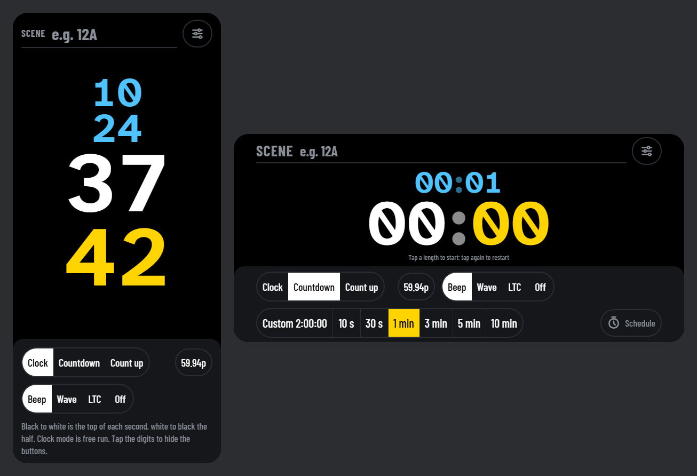
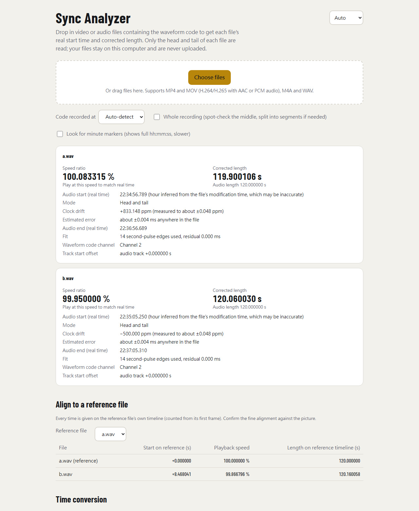

# slate-sync

**English** · [繁體中文](README.zh-TW.md)

**Keep long multi-camera and multi-recorder shoots in sync, down to the frame, with nothing but a phone.**

Every camera and audio recorder runs on its own clock, and those clocks drift. At a typical 833 ppm, two devices are already **3 seconds apart after one hour**. Timecode boxes fix this, but they cost money and need a free input on every device.

slate-sync turns a phone into a sync slate. Record it at the head and tail of each take. The analyzer then reads every file and tells you each file's **true start time** and its **corrected length**. With both right, every frame and every audio sample lands at its true moment.

[](https://sinnoken.github.io/slate-sync/)
[](LICENSE)



*The sync slate on a phone. Held upright, the clock shows hours, minutes, seconds and frames on four rows. Held sideways, it shows two rows. Tap the digits to hide the controls.*



*The analyzer in a desktop browser: two recordings, one +833 ppm fast and one −500 ppm slow, aligned to a reference file.*

## Features

- **Phone slate, no install.** Open the page and add it to the home screen. It runs full screen and **works offline** after the first visit.
  - **Clock, countdown or count-up**, with scheduled starts.
  - **Full-screen black/white square wave.** Black to white marks the whole second, so a camera that only sees the screen can still be aligned.
  - **AprilTag visual code.** A machine-readable tag that changes on every whole second, together with the waveform code. A camera that films only the screen can then be timed automatically.
  - **Audio sync signal:** beep, **waveform code** or **LTC**, at 23.976 to 120 fps.
- **Waveform code you can read by eye.** Each second's number is encoded as pulse counts, so you can read it in any editor's waveform view. It survives clipping, limiters, auto gain and lossy compression, and works through the phone speaker and a camera's built-in mic.
- **Drag-and-drop analyzer in the browser.** Files never leave your computer. It reads only the head and tail of each file, not the whole recording.
  - **Per file:** speed ratio, corrected length, true start time and clock drift in ppm.
  - **Against a reference file:** each file's start offset and playback speed, plus conversion of any moment between files.
  - **Picture-only files:** reads the AprilTag from the picture when a file has no waveform code.
  - **Audio/video sync check:** when a file has both the tag and the waveform code, reports how far picture and sound are apart, how much that varies, and whether it drifts.
- **English, 繁體中文, 日本語 and 한국어.** The interface follows your device language, and you can switch it from the page.
- **Command-line version** (Python + ffmpeg) for every format ffmpeg can read, with JSON output for scripts.
- **Measured accuracy:** on test files, speed-ratio error is 0.01–0.06 ppm and start/length error under 0.01 ms (see [testing](docs/testing.md)).

## How it works

1. **Before the shoot.** Feed one audio channel of each recorder or camera from the phone's headphone output (attenuate it for a MIC input), and set the slate to **waveform code**. A device with no audio input can record the phone speaker through its built-in mic:
   - within 30 cm it is most reliable;
   - up to 1 m works in a quiet room;
   - don't send LTC over the air.
2. **At the head and the tail.** Record the slate for at least one minute, so it crosses a full minute and the minute marker is captured. You can unplug it in between.
   - **Cameras that only see picture:** set Settings → Visual sync signal to **AprilTag** and film the phone so the tag fills a good part of the frame, in focus and facing the camera. Tap the digits to hide the controls, which makes the tag larger.
3. **Afterwards.** Drop all files into the analyzer (or run `slate_sync.py`).
4. **In your editor.** Align cameras by picture and use the analyzer's numbers to check and convert. Correct each file with its speed ratio, adjusted frame rate or corrected length.

## Quick start

| Tool | Where | How |
|---|---|---|
| **Sync slate** | Phone browser | Open <https://sinnoken.github.io/slate-sync/> and tap the slate. To install: on iPhone, Safari → Share → Add to Home Screen; on Android, Chrome → menu → Install app. |
| **Analyzer** | Desktop browser (Chrome, Edge, desktop Firefox, Safari 26+) | Open the same site and choose the analyzer, then drag in files. |
| **Command line** | Python 3.8+, numpy, ffmpeg; pupil-apriltags for picture | See below. |

```bash
pip install -r python/requirements.txt          # also needs ffmpeg / ffprobe
pip install pupil-apriltags                     # only for reading the AprilTag from picture
python python/slate_sync.py A001.MP4 ZOOM0001.WAV --ref A001.MP4
python python/slate_sync.py *.MP4 --ref A001.MP4 --at B002.MP4=125.5   # where B002 at 125.5 s falls in every other file
```

| Option | Meaning |
|---|---|
| `--ref FILE` | Reference file for alignment (default: the first file) |
| `--at FILE=SEC` | Convert a moment in one file to every other file; repeatable |
| `--channel N` | Channel holding the waveform code (0-based); auto-detected by default, may differ between head and tail |
| `--fps 59.94` | Frame rate when the file doesn't record one; 29.97, 59.94 etc. use exact fractions |
| `--only head` / `--only tail` | Only the head or tail was recorded: skip searching the other end (auto-detected otherwise, just slower) |
| `--full` | Code runs through the whole file: spot-check 3 points in the middle and switch to segmented speed if drift is not linear (off by more than 2 ms) |
| `--probe N` | Number of middle spot checks (implies `--full`) |
| `--target 1` | Target accuracy in ms anywhere in the file; reading stops once reached |
| `--search 30` / `--max-read 120` | Minutes to search inward from each end / seconds to keep reading after the code is found |
| `--minute` | Read about one more minute to find the minute marker and show full hh:mm:ss |
| `--av` | Also read the AprilTag from picture and check audio/video sync, even when the waveform code is found |
| `--distance M` | Phone-to-microphone distance in meters; the sound travel time (about 2.9 ms/m) is subtracted |
| `--av-ref FILE` | Reference file for the audio/video sync check; other files also list their difference from it |
| `--no-hwaccel` | Decode picture in software only (by default the GPU is tried first: `cuda`, then `d3d11va`, falling back to software) |
| `--json` | JSON output |

Picture is decoded only when needed: when a file has no waveform code, or with `--av`. It follows the same head/tail reading and stopping rules as audio. The tag, timing and report fields are specified in [docs/visual-code.md](docs/visual-code.md).

## Modes

The analyzer picks the mode itself and states it in the report.

| You recorded | Mode | Notes |
|---|---|---|
| Head and tail | Head + tail | Both ends fitted together; best accuracy |
| Only head or only tail | Head only / tail only | Uses that end's local rate; drift from temperature changes during the take is not covered |
| The whole take (`--full`) | Full | Spot-checks the middle; outputs segmented speed if drift is not linear |

Every second that is read goes into one fit. While reading, the analyzer estimates the worst-case error anywhere in the file and stops as soon as it meets the target.

## Accuracy and limits

- **Accuracy on test files:** speed-ratio error is about 0.01–0.06 ppm, and start and length errors are under 0.01 ms. With 20 dB of clipping, the speed error is about 1 ppm. Details are in [docs/testing.md](docs/testing.md).
- **Straight-line correction.** The analyzer corrects with one straight line between head and tail. If the clock rate changes during the take (for example with temperature), the middle departs from that line; use `--full` to measure it.
- **Any length.** The number of whole minutes between head and tail is derived from the clock rate measured at each end, so no minute marker is needed.
- **Start-time window.** Cross-file start positions are matched by second, so files must start within ±30 s of each other (±30 min when `--minute` finds the minute marker; ±4.5 min when the AprilTag is read). Otherwise align cameras by picture.
- **Picture precision.** Timing read from the AprilTag is accurate to about half a frame per edge, much coarser than the waveform code. When a file has both, timing comes from the audio and the picture is used for the sync check. Measured results are in [docs/testing.md](docs/testing.md).
- **Audio/video offset.** A file's offset is the slate's own offset plus the camera's. Between cameras filmed with the same slate, the difference is reliable; an absolute value needs a reference device known to be in sync.
- **Video decoding.** Reading the AprilTag decodes the picture at the head and tail, starting from the previous keyframe. This reads far more data than audio and takes longer. In the browser, H.265 support depends on the browser and operating system.
- **Audio track.** Only the first audio track is read.
- **Formats.** The web analyzer does not support AVCHD (.MTS, usually AC-3 audio), MXF or fragmented MP4; use the Python version for those.
- **Real devices.** All validation used software-generated signals, so test with your own devices before relying on it.

## Self-hosting

Both web tools are single HTML files with no build step and no server code.

- **GitHub Pages.** Fork the repo and set Settings → Pages → Source to **GitHub Actions**. Every push to `main` then publishes `web/` through [`.github/workflows/pages.yml`](.github/workflows/pages.yml). Any static host with HTTPS also works.
- **Opening the analyzer locally.** It decodes AAC with WebCodecs, which needs `https://` or `http://localhost`. Opened from `file://`, it can only analyze WAV and PCM audio.
  ```bash
  python -m http.server 8000      # then open http://localhost:8000/web/sync-analyzer.html
  ```
- **Updates and offline use.** Installed copies update in the background and show the new version on the next launch. Bump `VERSION` in [`web/sw.js`](web/sw.js) only when you change the service worker itself or want old caches cleared.

## Repository layout

| Path | What it is |
|---|---|
| [`web/sync-slate.html`](web/sync-slate.html) | Sync slate (phone PWA) |
| [`web/sync-analyzer.html`](web/sync-analyzer.html) | Analyzer (desktop browser) |
| [`python/slate_sync.py`](python/slate_sync.py) | Command-line analyzer |
| [`tests/make_test_media.py`](tests/make_test_media.py) | Generates test files with a known drift, with or without the AprilTag |
| [`tests/check_visual_code.py`](tests/check_visual_code.py) | Checks that the embedded tag tables match and every ID is detected |
| [`tests/check_read_audio.py`](tests/check_read_audio.py) | Checks that audio reads start on the exact requested sample (AAC and WAV) |
| [`tests/check_cli_encoding.py`](tests/check_cli_encoding.py) | Checks that the report prints fully on a non-UTF-8 console |
| [`tests/check_web.js`](tests/check_web.js) | Checks the web pages' script syntax and that all four languages have the same strings |
| [`docs/`](docs/README.md) | Specifications and test results (Traditional Chinese); [the index](docs/README.md) lists which document owns which specification |
| [`CHANGELOG.md`](CHANGELOG.md) | Release notes (Traditional Chinese) |

## License

[MIT](LICENSE). The embedded AprilTag code table (BSD-2-Clause) and the js-aruco2 detector (MIT) keep their own notices; see [THIRD_PARTY_NOTICES.md](THIRD_PARTY_NOTICES.md).
