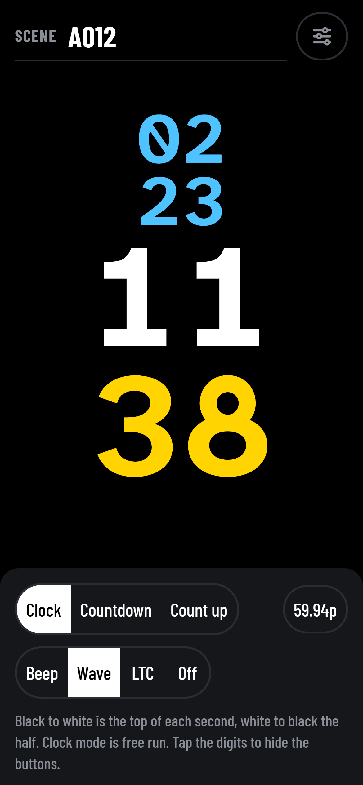
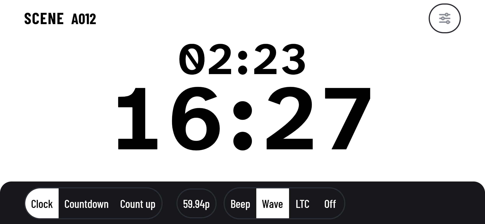
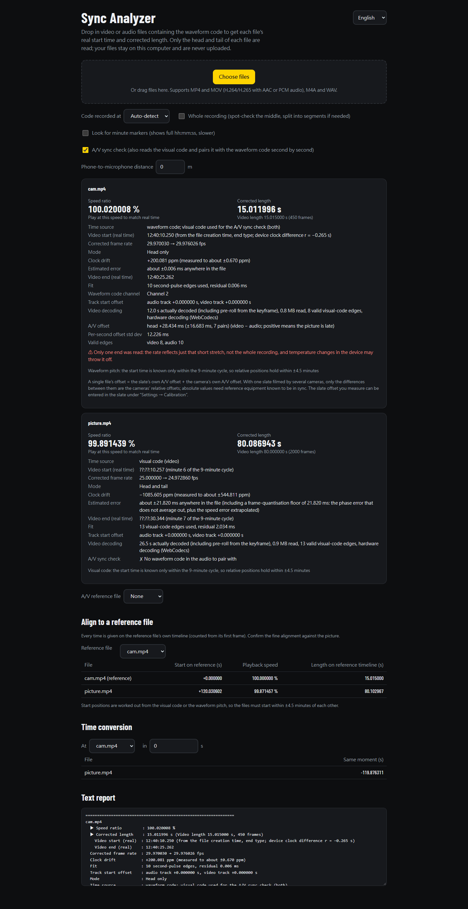
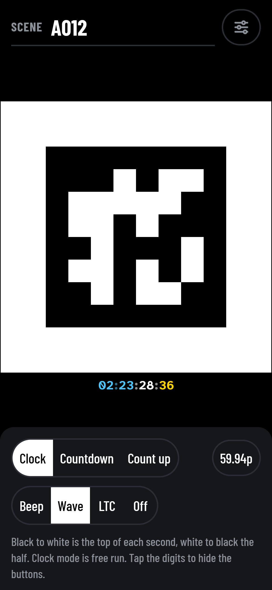
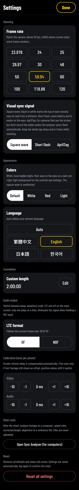
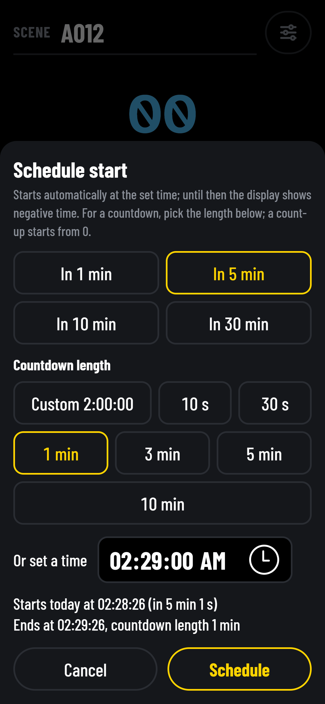
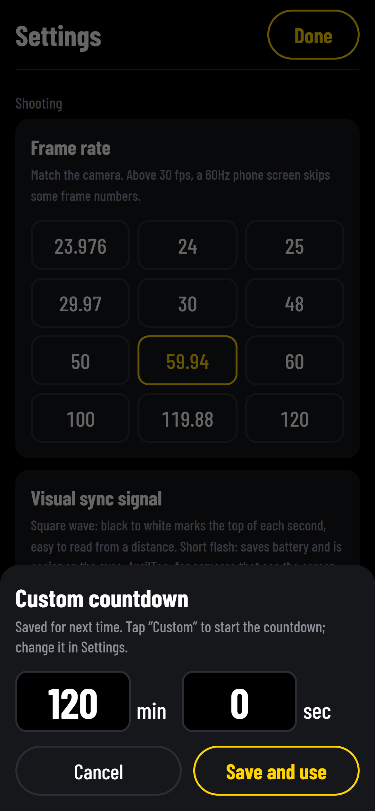
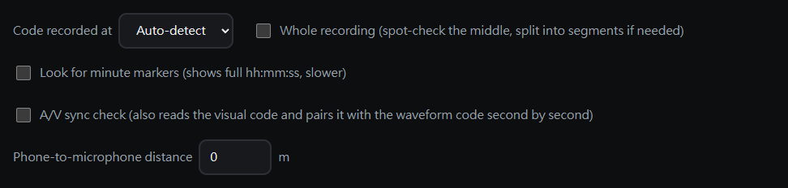
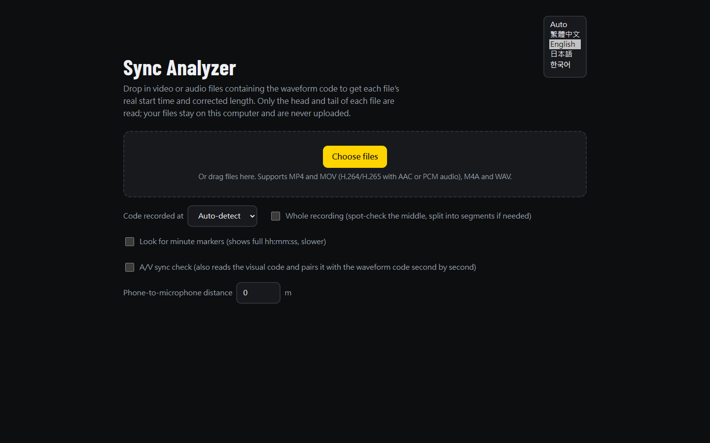

# slate-sync

**English** · [繁體中文](README.zh-TW.md)

**Keep long multi-camera and multi-recorder shoots in sync, down to the frame, with nothing but a phone.**

Every camera and audio recorder runs on its own clock, and those clocks drift. At a typical 833 ppm, two devices are already **3 seconds apart after one hour**. Timecode boxes fix this, but they cost money and need a free input on every device.

slate-sync turns a phone into a sync slate. Record it at the head and tail of each take. The analyzer then reads every file and tells you each file's **true start time** and its **corrected length**. With both right, every frame and every audio sample lands at its true moment.

[](https://sinnoken.github.io/slate-sync/)
[](LICENSE)

<p>


</p>

*The sync slate on a phone. Held upright, the clock shows hours, minutes, seconds and frames on four rows. Held sideways, it shows two rows. Tap the digits to hide the controls.*



*The analyzer in a desktop browser after an analysis: results, audio/video sync check, alignment and conversion, and the text report.*

<details>
<summary>More screens: AprilTag mode, settings, dialogs, analyzer menus</summary>






*The slate: AprilTag visual code, the settings page (full height), scheduling a start, and a custom countdown.*



*The analyzer's options bar.*



*The analyzer's language menu, top right.*

</details>

## Features

- **Phone slate, no install.** Open the page and add it to the home screen. It runs full screen and **works offline** after the first visit.
  - **Clock, countdown or count-up**, with scheduled starts.
  - **Full-screen black/white square wave.** Black to white marks the whole second, so a camera that only sees the screen can still be aligned.
  - **AprilTag visual code.** A machine-readable tag that changes on every whole second, together with the waveform code. A camera that films only the screen can then be timed automatically.
  - **Audio sync signal:** beep, **waveform code** or **LTC**, at 23.976 to 120 fps.
- **Waveform code you can read by eye.** Each second's number is encoded as pulse counts, so you can read it in any editor's waveform view. It survives clipping, limiters, auto gain and lossy compression, and works through the phone speaker and a camera's built-in mic.
  - **A 9-minute cycle in the pitch.** Each second's pitch is one of 11 pentatonic notes. Together with the second's number it gives the position within 9 minutes, the same cycle the AprilTag uses.
- **Drag-and-drop analyzer in the browser.** Files never leave your computer. It reads only the head and tail of each file, not the whole recording.
  - **Per file:** speed ratio, corrected length, true start time and clock drift in ppm.
  - **Full start clock:** hours, minutes and seconds worked out from the file's creation time (MP4 creation_time, WAV BWF time_reference).
  - **Reads LTC:** LTC recorded on an audio track (23.976 to 30 fps, DF and NDF) can be analyzed too.
  - **Against a reference file:** each file's start offset and playback speed, plus conversion of any moment between files.
  - **Picture-only files:** reads the AprilTag from the picture when a file has no waveform code.
  - **Audio/video sync check:** when a file has both the tag and the waveform code, reports how far picture and sound are apart, how much that varies, and whether it drifts.
- **Command-line version** (Node + ffmpeg) on the same analysis core as the web page, for every format ffmpeg can read, with JSON output for scripts.
- **English, 繁體中文, 日本語 and 한국어.** The interface follows your device language, and you can switch it from the page.
- **Measured accuracy:** on test files, speed-ratio error is 0.01–0.06 ppm and start/length error under 0.01 ms (see [testing](docs/testing.md)).

## How it works

1. **Before the shoot.** Feed one audio channel of each recorder or camera from the phone's headphone output (attenuate it for a MIC input), and set the slate to **waveform code**. A device with no audio input can record the phone speaker through its built-in mic:
   - within 30 cm it is most reliable;
   - up to 1 m works in a quiet room;
   - don't send LTC over the air.
2. **At the head and the tail.** Record the slate for 5–10 seconds at the head and at the tail of each take. You can unplug it in between (see [Recording guide](#recording-guide)).
   - **Cameras that only see picture:** set Settings → Visual sync signal to **AprilTag** and film the phone so the tag fills a good part of the frame, in focus and facing the camera. Tap the digits to hide the controls, which makes the tag larger.
3. **Afterwards.** Drop all files into the analyzer, or run the command line.
4. **In your editor.** Align cameras by picture and use the analyzer's numbers to check and convert. Correct each file with its speed ratio, adjusted frame rate or corrected length.

## Recording guide

- **Head and tail.** Record the slate at both the head and the tail of each take. Accuracy then does not depend on the length of the take, and 5–10 seconds at each end is enough.
- **Head only.** The error grows with the length of the take. Over the air, record at least 30 seconds, and only for short takes.
- **Seconds and time information.** At least 3 seconds at an end gives the 9-minute cycle. For the minute marker, record across a whole minute (:00) and add `--minute` (in the web analyzer, tick "Look for minute markers").
- **Long takes.** As the camera body warms up, its clock rate changes and the drift is no longer linear. Record the slate once more in the middle, or use `--full`.
- **Sound travel.** Sound takes about 2.9 ms per meter. This is a fixed offset: it moves the start but not the speed ratio, and `--distance` subtracts it.

Expected errors for each way of recording, and how they are calculated, are in [docs/precision.md](docs/precision.md) (Traditional Chinese).

## Quick start

| Tool | Where | How |
|---|---|---|
| **Sync slate** | Phone browser | Open <https://sinnoken.github.io/slate-sync/> and tap the slate. To install: on iPhone, Safari → Share → Add to Home Screen; on Android, Chrome → menu → Install app. |
| **Analyzer** | Desktop browser (Chrome, Edge, desktop Firefox, Safari 26+) | Open the same site and choose the analyzer, then drag in files. |
| **Command line** | Node 20 or later, ffmpeg / ffprobe | See below. |

```bash
node cli/slate-sync.mjs A001.MP4 ZOOM0001.WAV --ref A001.MP4
node cli/slate-sync.mjs *.MP4 --ref A001.MP4 --at B002.MP4=125.5   # where B002 at 125.5 s falls in every other file
npm install -g .                                                   # once, from the repo root; then just run slate-sync
```

| Option | Meaning |
|---|---|
| `--ref FILE` | Reference file for alignment (default: the first file) |
| `--at FILE=SEC` | Convert a moment in one file to every other file; repeatable |
| `--channel N` | Channel holding the waveform code (0-based); auto-detected by default, may differ between head and tail |
| `--fps 59.94` | Frame rate; read from the file by default. 29.97, 59.94 etc. use exact fractions |
| `--only head` / `--only tail` | Only the head or tail was recorded: skip searching the other end (auto-detected otherwise, just slower) |
| `--full` | Code runs through the whole file: spot-check 3 points in the middle and switch to segmented speed if drift is not linear (off by more than 2 ms) |
| `--probe N` | Number of middle spot checks (implies `--full`) |
| `--target 1` | Target accuracy in ms anywhere in the file; reading stops once reached |
| `--search 30` / `--max-read 120` | Minutes to search inward from each end / seconds to keep reading after the code is found |
| `--minute` | Read about one more minute to find the minute marker and show full hh:mm:ss |
| `--av` | Also read the AprilTag from picture and check audio/video sync, even when the waveform code is found |
| `--distance M` | Phone-to-microphone distance in meters; the sound travel time at 343 m/s is subtracted |
| `--av-ref FILE` | Reference file for the audio/video sync check; other files also list their difference from it |
| `--no-hwaccel` | Decode picture in software only (by default the GPU is tried first: `cuda`, then `d3d11va`, falling back to software) |
| `--json` | JSON output |
| `--lang L` | Report language: `zh-Hant` (default), `en`, `ja`, `ko` |

Exit codes: 0 every file was analyzed; 1 a file failed (the others are still reported); 2 invalid options.

Picture is decoded only when needed: when a file has no waveform code, or with `--av`. It follows the same head/tail reading and stopping rules as audio. The tag, timing and report fields are specified in [docs/visual-code.md](docs/visual-code.md).

## Modes

The analyzer picks the mode itself and states it in the report.

| You recorded | Mode | Notes |
|---|---|---|
| Head and tail | Head + tail | Both ends fitted together; best accuracy |
| Only head or only tail | Head only / tail only | Uses that end's local rate; drift from temperature changes during the take is not covered |
| The whole take (`--full`) | Full | Spot-checks the middle; outputs segmented speed if drift is not linear |

Every second that is read goes into one fit. While reading, the analyzer estimates the worst-case error anywhere in the file and stops as soon as it meets the target.

## Accuracy and limits

- **Accuracy on test files:** speed-ratio error is about 0.01–0.06 ppm, and start and length errors are under 0.01 ms. With 20 dB of clipping, the speed error is about 1 ppm. Details are in [docs/testing.md](docs/testing.md).
- **Straight-line correction.** The analyzer corrects with one straight line between head and tail. If the clock rate changes during the take (for example with temperature), the middle departs from that line; use `--full` to measure it.
- **Any length.** The number of whole minutes between head and tail is derived from the clock rate measured at each end, so no minute marker is needed.
- **Start-time window.** Cross-file start positions are matched on the cycle each file reveals, so the window depends on what was read (see the cycle table in [docs/start-time.md](docs/start-time.md)). Beyond it, align cameras by picture.
- **Picture precision.** Timing read from the AprilTag is accurate to about half a frame per edge, much coarser than the waveform code. When a file has both, timing comes from the audio and the picture is used for the sync check. Measured results are in [docs/testing.md](docs/testing.md).
- **Audio/video offset.** A file's offset is the slate's own offset plus the camera's. Between cameras filmed with the same slate, the difference is reliable; an absolute value needs a reference device known to be in sync.
- **Video decoding.** Reading the AprilTag decodes the picture at the head and tail, starting from the previous keyframe. This reads far more data than audio and takes longer. In the browser, H.265 support depends on the browser and operating system.
- **Audio track.** Only the first audio track is read.
- **Formats.** The web analyzer does not support AVCHD (.MTS, usually AC-3 audio), MXF or fragmented MP4; use the command line for those.
- **Real devices.** Validation mostly used software-generated signals, so test with your own devices before relying on it.

## Why not LTC? How it compares

| Scheme | Designed for | How time is carried | Source |
|---|---|---|---|
| LTC (SMPTE ST 12-1) | Time code recorded on a longitudinal track and distributed like audio; the interface is specified into a 1 kΩ load, on XLR or BNC connectors | 80 bits per frame, biphase mark coded, with hh:mm:ss:ff and a sync word | [ITU-R BR.780-2](https://www.itu.int/dms_pubrec/itu-r/rec/br/R-REC-BR.780-2-200504-W!!PDF-E.pdf) |
| IRIG-B AM (IRIG 200) | Time code for test ranges and instrumentation | 100 bits per second, one frame per second; 0, 1 and position marker are 2, 5 and 8 ms pulses amplitude-modulated on a 1 kHz sine (10:3 mark-to-space) | [IRIG Standard 200-04](https://apps.dtic.mil/sti/tr/pdf/ADA640534.pdf) |
| NIST WWV | Shortwave time broadcast | A 5 ms, 1000 Hz tick each second, with 10 ms of silence before and 25 ms after; date, hour and minute go separately in a time code on a 100 Hz subcarrier at 1 bit per second, one frame per minute; plus a voice announcement | [NIST SP 250-67](https://nvlpubs.nist.gov/nistpubs/Legacy/SP/nistspecialpublication250-67.pdf) |
| ggwave | Sending data between devices by sound | Multi-tone FSK at 8–16 bytes per second with Reed-Solomon error correction; it carries data, not a time reference | [ggerganov/ggwave](https://github.com/ggerganov/ggwave) |
| Audio watermark (ATSC A/334) | A data channel embedded in broadcast audio, aimed at being imperceptible | Embedded in the 2.5–5 kHz band, one 159-bit cell every 1.5 s; resilient to lossy compression, read by a dedicated extractor | [ATSC A/334:2016](https://www.atsc.org/wp-content/uploads/2021/04/A334-2016-Audio-Watermark-Emission.pdf) |
| Editor auto-sync | Aligning the files of one shoot | Finds sync points from markers, timecode, file creation date or audio content; with audio, every file must have recorded the same sound | [Final Cut Pro User Guide](https://support.apple.com/guide/final-cut-pro/sync-audio-and-video-verc1fabc30/mac) |

- **Time code standards assume a cable.** LTC and IRIG specify an electrical interface, and room reverberation breaks LTC's zero crossings (see [docs/ltc.md](docs/ltc.md)). A device that can only record through its built-in mic needs a different signal.
- **WWV is the closest idea to the waveform code.** WWV separates each second's timing tick from the time information: the tick only marks the second, and the information is sent apart from it. The waveform code does the same: the leading edge of the sync pulse is the whole second, and the number follows in short pulses.
- **What this project adds:**
  - readable by eye: the number is a count of pulses, visible in an editor's waveform view;
  - unaffected by auto gain and compression: only pulse length, count and position matter, not level;
  - one cycle shared with the picture: the pitch and the AprilTag mark the same position within 9 minutes, so sound and picture pair second by second;
  - a new pitch every second, so an editor's audio auto-sync does not slip by whole seconds ([docs/waveform-code.md](docs/waveform-code.md)).

## Self-hosting and development

The web pages are built from `web/` and `src/` into `dist/`; the analyzer becomes a single HTML file. Node 20 or later is required.

```bash
npm ci          # first time: install the build tool (esbuild)
npm run build   # build into dist/
npm run dev     # development: rebuild on change, open http://localhost:8000/
npm test        # all tests (needs ffmpeg / ffprobe; the web tests also need Chrome or Edge)
```

- **GitHub Pages.** Fork the repo and set Settings → Pages → Source to **GitHub Actions**. Every push to `main` then builds `dist/`, runs the tests and publishes the tested build through [`.github/workflows/test.yml`](.github/workflows/test.yml). Any static host with HTTPS also works.
- **Opening the analyzer locally.** It decodes AAC with WebCodecs, which needs `https://` or `http://localhost` (`npm run dev` provides it). Opened from `file://`, `dist/sync-analyzer.html` can only analyze WAV and PCM audio.
- **Updates and offline use.** Installed copies update in the background and show the new version on the next launch. Bump `VERSION` in [`web/sw.js`](web/sw.js) only when you change the service worker itself or want old caches cleared.

## Repository layout

| Path | What it is |
|---|---|
| [`web/`](web/) | Home page, the sync slate [`sync-slate.html`](web/sync-slate.html) (phone PWA) and the PWA files; copied as is into `dist/` |
| [`src/core/`](src/core/) | Analysis core: waveform code, LTC, visual code, fitting, reports and the four languages (shared by the web page and the command line) |
| [`src/web/`](src/web/) | Web analyzer: MP4/WAV reading, WebCodecs decoding and the page; built into `dist/sync-analyzer.html` |
| [`cli/`](cli/) | Command-line analyzer: reads files with ffmpeg / ffprobe and hands them to the core |
| [`scripts/build.mjs`](scripts/build.mjs) | Build and development server |
| [`tests/`](tests/) | Tests (`node --test`), fixed test files (`tests/fixtures/`) and [`make_test_media.mjs`](tests/make_test_media.mjs), which generates test files with a known drift |
| [`docs/`](docs/README.md) | Specifications and test results (Traditional Chinese); [the index](docs/README.md) lists which document owns which specification |
| [`CHANGELOG.md`](CHANGELOG.md) | Release notes (Traditional Chinese) |

## License

[MIT](LICENSE). The embedded AprilTag code table (BSD-2-Clause) and the js-aruco2 detector (MIT) keep their own notices; see [THIRD_PARTY_NOTICES.md](THIRD_PARTY_NOTICES.md).
