# slate-sync

[English](README.md) · **繁體中文**

**只用一支手機，讓長時間多機錄影、錄音的檔案精準對齊到每一格。**

每台攝影機和錄音機都用自己的時鐘，而時鐘都有誤差。以常見的 833 ppm 來算，兩台設備**錄一小時就差 3 秒**。時間碼盒可以解決，但要花錢，每台設備也得空出一個輸入。

slate-sync 把手機變成同步場記板。每段開頭和結尾各錄一次，分析器讀出每個檔案的**起點真實時間**與**校正後長度**。兩者都正確，檔案裡的每一格畫面、每一個聲音取樣就會落在正確的真實時間上。

[](https://sinnoken.github.io/slate-sync/)
[](LICENSE)

<p>
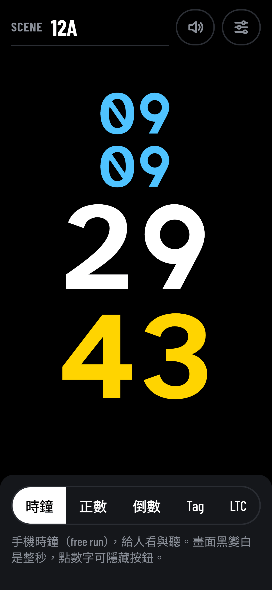
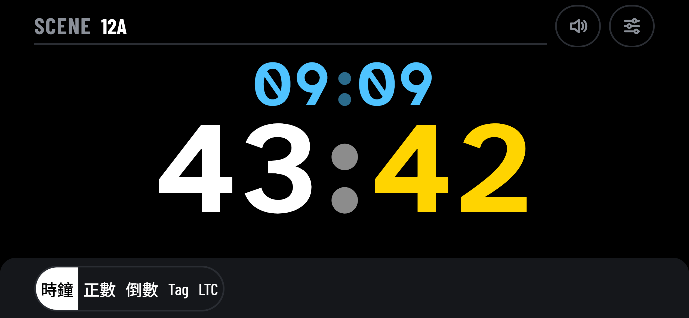
</p>

*手機上的同步場記板（時鐘模式）：直拿時時、分、秒、格分四行，橫拿時兩行；下方切換五種模式，右上角是靜音與設定；點一下數字可隱藏按鈕。*

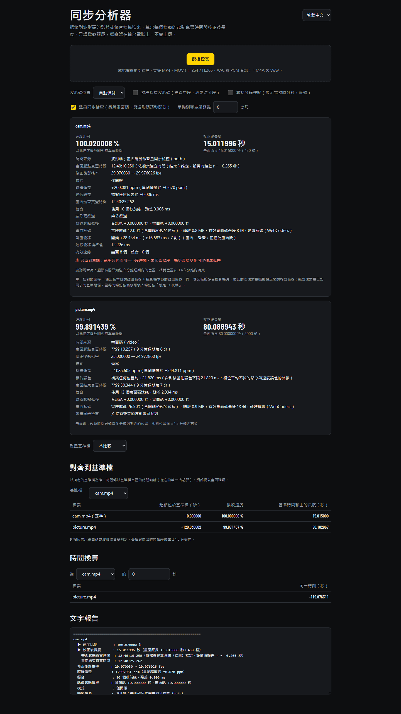

*電腦瀏覽器中的同步分析器：分析完成後的整頁，含分析結果、聲畫同步檢查、對齊與換算與文字報告。*

<details>
<summary>更多畫面：倒數、Tag 與 LTC 模式、設定頁、對話框、分析器選單</summary>

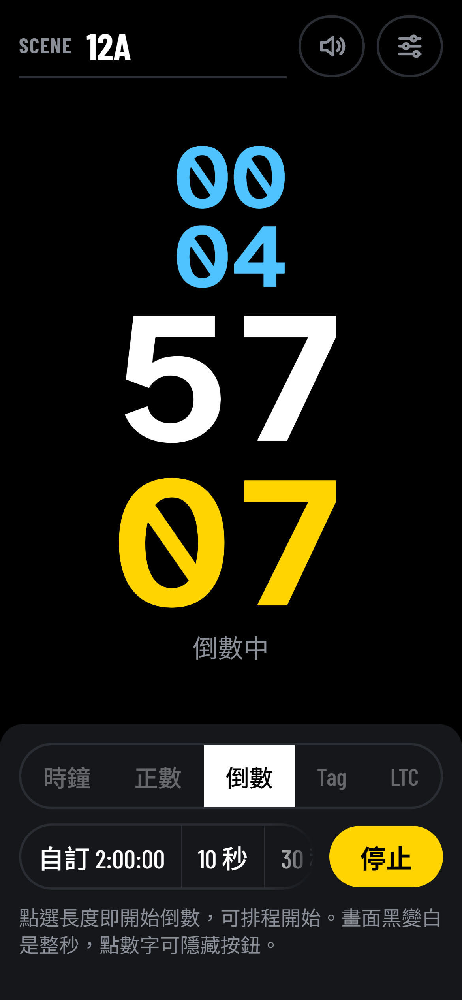
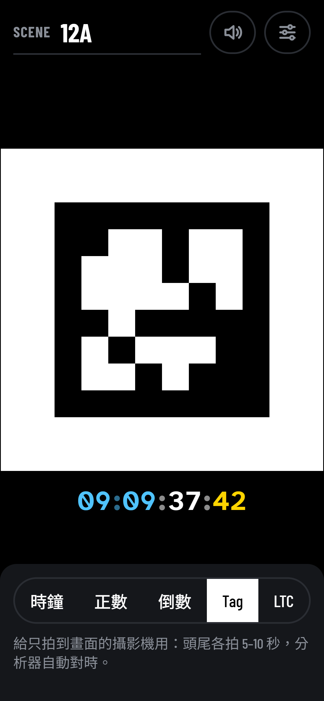
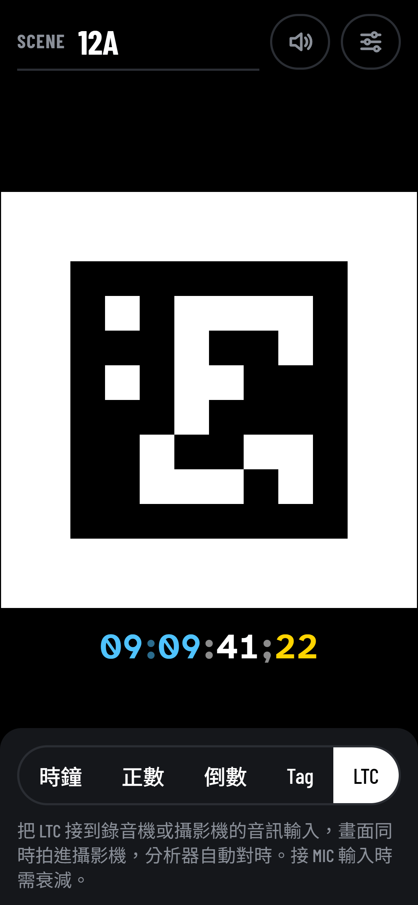

*場記板：倒數進行中、Tag 模式（AprilTag＋手機時鐘）、LTC 模式（AprilTag＋輸出中的 LTC 時間碼）。*

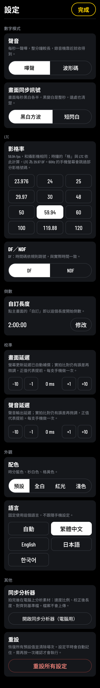
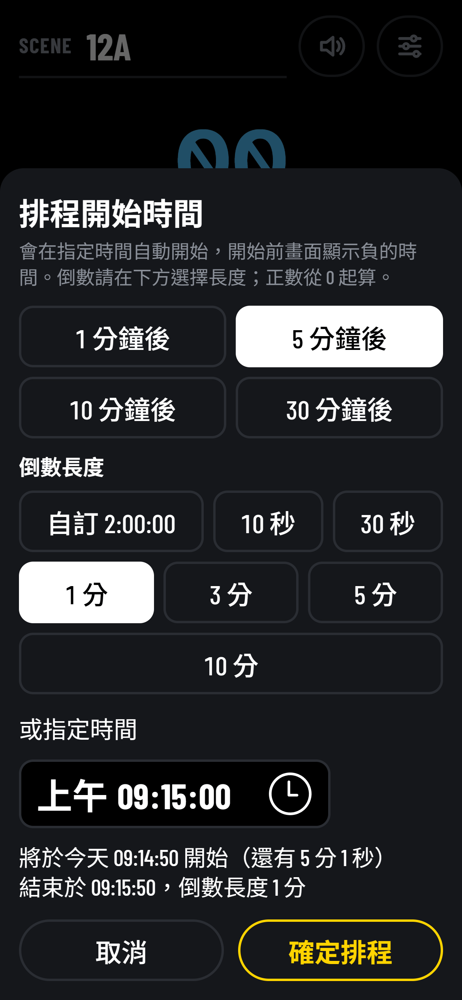
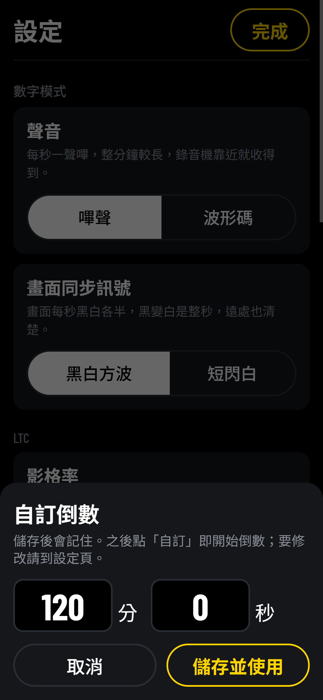

*場記板：設定頁（完整高度）、排程開始時間、自訂倒數。*

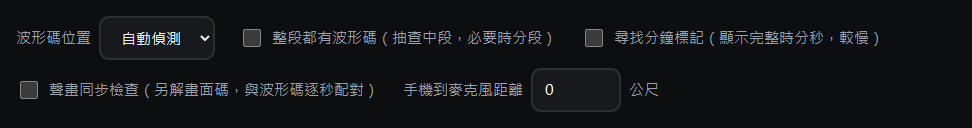

*分析器的選項列。*

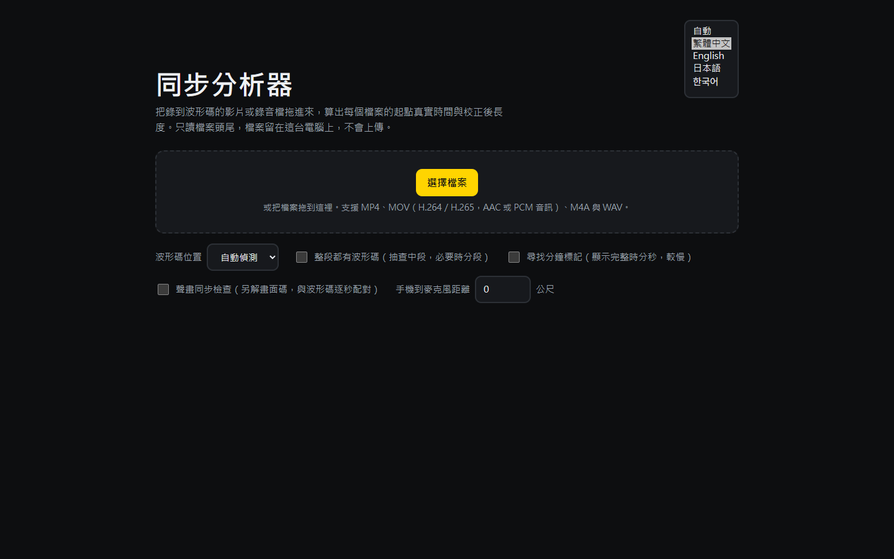

*分析器右上角的語言選單。*

</details>

## 特色

- **手機場記板，免安裝**：開啟網頁、加到主畫面即可，全螢幕，第一次開啟後**離線也能用**。
  - **五種模式**，畫面與聲音由模式決定：
    - **時鐘、正數、倒數**給人看與聽：大字的時間、全螢幕黑白方波（黑變白就是整秒）或短閃白，聲音是嗶聲或**波形碼**；正數與倒數可排程開始。
    - **Tag** 給只拍得到螢幕的攝影機：全螢幕的 **AprilTag 畫面碼**每個整秒換一次，聲音是波形碼，分析器自動對時。
    - **LTC** 給能錄時間碼的設備：同樣顯示 AprilTag，聲音輸出 **LTC**。
  - **靜音鈕**：五種模式都有效，只關聲音、畫面照常，會記住。
  - **設定頁**：放數字模式的聲音、影格率、校準等少用的設定；模式與各項設定的規格見 [docs/slate-ui.md](docs/slate-ui.md)。
- **用眼睛就能讀的波形碼**：每秒的數字以脈衝數量表示，在任何剪輯軟體的波形畫面都看得出來。不怕削波、限幅、自動增益與有損壓縮；用手機喇叭播放、攝影機內建麥克風收音也能用。
  - **音高帶出 9 分鐘循環**：每秒的音高取自五聲音階 11 個音，和秒數一起標出 9 分鐘內的位置，與 AprilTag 共用同一個循環。
- **瀏覽器拖放分析**：檔案不會上傳，只讀每個檔案的頭尾，不必讀完整段。
  - **每個檔案**：速度比例、校正後長度、起點真實時間、時鐘偏差（ppm）。
  - **完整的起點時鐘**：由檔案建立時間（MP4 的 creation_time、WAV 的 BWF time_reference）推出時:分:秒。
  - **讀 LTC**：錄進音訊軌的 LTC（23.976–30 fps，DF 與 NDF）也能分析。
  - **對齊到基準檔**：各檔案的起點位置、播放速度，以及任一時刻在檔案之間的換算。
  - **只有畫面的檔案**：檔案讀不到波形碼時，改從畫面讀 AprilTag。
  - **聲畫同步檢查**：同一個檔案同時有畫面碼與波形碼時，報告畫面與聲音相差多少、逐秒的抖動，以及是否漂移。
- **命令列版本**（Node＋ffmpeg）：與網頁版共用同一份分析核心，支援 ffmpeg 能讀的所有格式，可輸出 JSON 供腳本使用。
- **繁體中文、English、日本語、한국어**：介面跟著裝置語言自動切換，也可以在頁面上手動選擇。
- **實測精度**：以測試檔驗證，速度比例誤差 0.01–0.06 ppm，起點與長度誤差小於 0.01 毫秒（見[驗證方式與結果](docs/testing.md)）。

## 工作流程

1. **拍攝前**：每台錄音機或攝影機的一個聲道接手機的耳機輸出（MIC 輸入需衰減），場記板用 **Tag** 模式，或在時鐘、正數、倒數模式把「設定 → 聲音」設為「波形碼」；要錄 LTC、又拍得到畫面的設備改用 **LTC** 模式。沒有音訊輸入的設備，可以用手機喇叭播放、由內建麥克風收音：
   - 手機距麥克風 30 cm 內最穩定；
   - 1 m 內在安靜時仍可用；
   - 不要用 LTC 走空氣傳播。
2. **開頭與結尾**：每段錄影的開頭和結尾各錄場記板 5–10 秒，中間可以拔掉（見[錄製指引](#錄製指引)）。
   - **只拍得到畫面的攝影機**：場記板切到 **Tag** 模式，拍攝時讓 tag 清楚、正面、佔畫面夠大的範圍。點一下數字把按鈕藏起來，tag 會更大。
3. **事後分析**：把所有檔案丟進分析器，或執行命令列版。
4. **在剪輯軟體中**：跨機對齊以畫面為準，分析器的數字用來換算與確認；以速度比例、修正後影格率或校正後長度修正每個檔案。

## 錄製指引

- **開頭和結尾都錄**：每段錄影的開頭和結尾都錄到場記板，精度就和錄影長度無關，每端 5–10 秒就夠。
- **只錄開頭**：誤差隨錄影長度變大。空氣收音至少錄 30 秒，而且只適合短片。
- **秒數與時間資訊**：每端錄到 3 秒以上才讀得到 9 分鐘循環；要讀分鐘標記，就要錄過一個整分鐘（:00 秒），並加 `--minute`（網頁版勾選「尋找分鐘標記」）。
- **長時間錄影**：機身變熱會讓時鐘速率改變，造成非線性漂移。可以在中段再錄一次場記板，或用 `--full`。
- **聲音傳播**：每公尺延遲約 2.9 ms。這是固定偏移，只影響起點，不影響速度比例；可用 `--distance` 扣除。

各種錄法的預期誤差與計算方式見 [docs/precision.md](docs/precision.md)。

## 快速開始

| 工具 | 在哪裡用 | 怎麼用 |
|---|---|---|
| **同步場記板** | 手機瀏覽器 | 開啟 <https://sinnoken.github.io/slate-sync/>，點選場記板。安裝方式：iPhone 用 Safari → 分享 → 加入主畫面；Android 用 Chrome → 選單 → 安裝應用程式。 |
| **同步分析器** | 電腦瀏覽器（Chrome、Edge、Firefox 桌面版、Safari 26+） | 開啟同一個網址，選擇分析器，拖入檔案。 |
| **命令列** | Node 20 以上、ffmpeg／ffprobe | 見下方。 |

```bash
node cli/slate-sync.mjs A001.MP4 ZOOM0001.WAV --ref A001.MP4
node cli/slate-sync.mjs *.MP4 --ref A001.MP4 --at B002.MP4=125.5   # B002 的 125.5 秒對應各檔案的哪一秒
npm install -g .                                                   # 在 repo 根目錄執行一次，之後可直接用 slate-sync
```

| 選項 | 說明 |
|---|---|
| `--ref 檔名` | 對齊的基準檔，預設為第一個檔案 |
| `--at 檔名=秒` | 把某檔案的某一刻換算到其他檔案的時間，可重複 |
| `--channel N` | 指定波形碼所在聲道（0 起算），預設自動判斷，頭尾可不同 |
| `--fps 59.94` | 影格率，預設讀取檔案資訊；29.97、59.94 等自動使用精確分數 |
| `--only head`／`--only tail` | 只錄了開頭／結尾：略過另一端的搜尋（不加也會自動判斷，只是較慢） |
| `--full` | 整段都有波形碼：抽查中段 3 處，偏離直線超過 2 ms 時改為分段調速 |
| `--probe N` | 中段抽查處數（隱含 `--full`），越多分段越細 |
| `--target 1` | 目標精度：檔案任何位置的預估誤差（ms），達到即停止讀取 |
| `--search 30`／`--max-read 120` | 每端最多往內找幾分鐘／找到後最多再讀幾秒 |
| `--minute` | 讀到波形碼後再多讀約 1 分鐘尋找分鐘標記，以顯示完整的時分秒（預設讀到就停） |
| `--av` | 即使讀到波形碼，也從畫面讀 AprilTag 並做聲畫同步檢查 |
| `--distance M` | 手機到麥克風的距離（公尺），以 343 m/s 扣除聲音傳播時間 |
| `--av-ref 檔名` | 聲畫同步檢查的基準檔；其他檔案另列與它的差值 |
| `--no-hwaccel` | 畫面只用軟體解碼（預設先試 GPU：`cuda`、再 `d3d11va`，失敗時改用軟體） |
| `--json` | 以 JSON 輸出 |
| `--lang L` | 報告語言：`zh-Hant`（預設）、`en`、`ja`、`ko` |

結束代碼：0 全部檔案都分析成功；1 有檔案分析失敗（其餘檔案照樣輸出）；2 選項錯誤。

只有需要時才解畫面：檔案讀不到波形碼，或加了 `--av`。讀取頭尾與停止的規則和音訊相同。標記、時序與報告欄位的規格見 [docs/visual-code.md](docs/visual-code.md)。

## 模式

分析器會自動判斷模式，並在報告中標示。

| 你錄了 | 模式 | 說明 |
|---|---|---|
| 開頭與結尾 | 頭尾 | 兩端一起擬合，精度最好 |
| 只有開頭或只有結尾 | 僅開頭／僅結尾 | 用該端的局部速率；未涵蓋整段，機身溫度變化可能造成偏差 |
| 整段（加 `--full`） | 全段 | 抽查中段；漂移不是直線時輸出分段調速 |

所有讀到的秒都放進同一個擬合。分析器一邊讀一邊估算「檔案任何位置的預估誤差」，達到目標精度就停止。

## 精度與限制

- **測試檔精度**：速度比例誤差約 0.01–0.06 ppm，起點與長度誤差在 0.01 毫秒以內；削波 20 dB 時速度誤差約 1 ppm。詳見 [docs/testing.md](docs/testing.md)。
- **以直線修正**：分析器用頭尾之間的一條直線修正。拍攝中速率若有變化（例如溫度），中段會偏離直線，可用 `--full` 實測。
- **長度不限**：頭尾之間經過幾個整分鐘，由兩端各自量到的時鐘比例推算，不需要分鐘標記。
- **起點時間範圍**：跨檔案的起點位置由各檔案讀到的循環比對，比對範圍依讀到的資訊而定（見 [docs/start-time.md](docs/start-time.md) 的循環表）；超出時以畫面對齊。
- **畫面的精度**：從 AprilTag 讀到的每個邊緣精度約半格，比波形碼粗很多。檔案兩者都有時，時間結果取自音訊，畫面用於聲畫同步檢查。實測結果見 [docs/testing.md](docs/testing.md)。
- **聲畫偏移**：單一檔案的偏移 = 場記板本身的偏移 + 攝影機本身的偏移。同一個場記板拍多台攝影機時，彼此的差值可靠；絕對值需要已知同步的基準設備。
- **影片解碼**：讀 AprilTag 要從前一個關鍵格開始解頭尾的畫面，讀取量比音訊大很多、也比較久。網頁版能不能解 H.265 取決於瀏覽器與作業系統。
- **音訊軌**：只讀第一條音訊軌。
- **格式**：網頁版不支援 AVCHD（.MTS，多為 AC-3 音訊）、MXF 與片段式（fragmented）MP4，請改用命令列版。
- **實際設備**：驗證以軟體產生的訊號為主，正式使用前請先用自己的設備錄一段確認。

## 為什麼不用 LTC？與現有規格的比較

| 規格 | 設計用途 | 時間怎麼帶 | 來源 |
|---|---|---|---|
| LTC（SMPTE ST 12-1） | 錄在縱向音軌、像音訊一樣分配的時間碼；介面規格以 1 kΩ 負載量測，使用 XLR 或 BNC 接頭 | 每格 80 位元、雙相位標記碼（biphase mark），含時:分:秒:格與同步字 | [ITU-R BR.780-2](https://www.itu.int/dms_pubrec/itu-r/rec/br/R-REC-BR.780-2-200504-W!!PDF-E.pdf) |
| IRIG-B AM（IRIG 200） | 靶場與儀器的時間碼 | 每秒 100 位元、1 秒一框；0／1／位置標記為 2／5／8 ms 的脈寬，以 1 kHz 正弦波調幅（高低振幅 10:3） | [IRIG Standard 200-04](https://apps.dtic.mil/sti/tr/pdf/ADA640534.pdf) |
| NIST WWV | 短波授時廣播 | 每秒一個 5 ms、1000 Hz 的滴答，前留 10 ms、後留 25 ms 靜音；日期與時分另以 100 Hz 副載波的時間碼每秒送 1 位元，一分鐘一框；另有語音報時 | [NIST SP 250-67](https://nvlpubs.nist.gov/nistpubs/Legacy/SP/nistspecialpublication250-67.pdf) |
| ggwave | 用聲音在裝置之間傳資料 | 多音 FSK，每秒 8–16 位元組，Reed-Solomon 錯誤更正；傳的是資料，不是時間基準 | [ggerganov/ggwave](https://github.com/ggerganov/ggwave) |
| 音訊浮水印（ATSC A/334） | 嵌在廣播節目聲音裡、以不易察覺為目標的資料通道 | 嵌在 2.5–5 kHz 頻帶，每 1.5 秒一個 159 位元的資料單元；耐有損壓縮，需要專用解讀器 | [ATSC A/334:2016](https://www.atsc.org/wp-content/uploads/2021/04/A334-2016-Audio-Watermark-Emission.pdf) |
| 剪輯軟體的自動同步 | 對齊同一場拍攝的多個檔案 | 依標記、時間碼、檔案建立時間或聲音內容找同步點；用聲音時各檔案要錄到同一段聲音 | [Final Cut Pro 使用手冊](https://support.apple.com/guide/final-cut-pro/sync-audio-and-video-verc1fabc30/mac) |

- **時間碼規格預設走線路。** LTC 與 IRIG 的規格寫的是電氣介面，空氣傳播的迴響會破壞 LTC 的零交越（見 [docs/ltc.md](docs/ltc.md)）。只能用內建麥克風收音的設備，需要另一種訊號。
- **WWV 的思路最接近波形碼。** WWV 把每秒的對時音和時間資訊分開：滴答只負責標出整秒，資訊另外送。波形碼也一樣：同步脈衝的前緣就是整秒，數字放在後面的短脈衝。
- **本專案另外顧及：**
  - 人眼可讀：數字是脈衝的個數，在剪輯軟體的波形畫面就數得出來；
  - 不怕自動增益與壓縮：只看脈衝的長度、數量與位置，不看音量；
  - 與畫面碼共用循環：音高與 AprilTag 都標出同一個 9 分鐘循環內的位置，聲音與畫面可以逐秒配對；
  - 每秒換音高，剪輯軟體以聲音自動同步時不會錯開整數秒（[docs/waveform-code.md](docs/waveform-code.md)）。

## 自行架設與開發

網頁由 `web/` 與 `src/` 建置到 `dist/`；場記板與分析器各建置成單一 HTML 檔。需要 Node 20 以上。

```bash
npm ci          # 第一次：安裝建置工具（esbuild）
npm run build   # 建置到 dist/
npm run dev     # 開發：改檔後自動重建，開啟 http://localhost:8000/
npm test        # 全部測試（需要 ffmpeg／ffprobe，網頁測試另需 Chrome 或 Edge）
npm run screenshots   # 重拍 docs/images/ 的截圖（需要 Node 22 以上、ffmpeg 與 Edge 或 Chrome）
```

- **GitHub Pages**：fork 這個 repo，在 Settings → Pages 把 Source 設為「GitHub Actions」。之後每次推到 `main`，[`.github/workflows/test.yml`](.github/workflows/test.yml) 會建置 `dist/`、跑測試，通過後發布同一份建置結果。任何支援 HTTPS 的靜態網站空間也可以。
- **在本機開啟分析器**：分析器用 WebCodecs 解碼 AAC，必須在 `https://` 或 `http://localhost` 下開啟（`npm run dev` 即可）。直接用 `file://` 開啟 `dist/sync-analyzer.html` 時，只能分析 WAV 與 PCM 音訊。
- **更新與離線**：已安裝的 App 會在背景下載新版，下次開啟就是新版。只有修改 Service Worker 本身、或要清掉舊快取時，才需要改 [`web/sw.js`](web/sw.js) 的 `VERSION`。

## 檔案結構

| 路徑 | 內容 |
|---|---|
| [`web/`](web/) | 首頁與 PWA 檔案；建置時原樣複製到 `dist/` |
| [`src/core/`](src/core/) | 分析核心：波形碼、LTC、畫面碼、擬合、報告與四種語言（網頁與命令列共用）；[`slate.js`](src/core/slate.js) 是場記板、分析核心與測試共用的編碼（波形碼、LTC、tag） |
| [`src/web/`](src/web/) | 網頁：同步場記板 [`sync-slate.html`](src/web/sync-slate.html)＋[`slate.js`](src/web/slate.js)（手機 PWA），建置成 `dist/sync-slate.html`；分析器（MP4／WAV 讀取、WebCodecs 解碼與介面），建置成 `dist/sync-analyzer.html` |
| [`cli/`](cli/) | 命令列分析器：以 ffmpeg／ffprobe 讀檔，交給分析核心 |
| [`scripts/`](scripts/) | [`build.mjs`](scripts/build.mjs) 建置與開發伺服器；[`screenshots.mjs`](scripts/screenshots.mjs) 重拍文件截圖 |
| [`tests/`](tests/) | 測試（`node --test`）、固定的測試檔（`tests/fixtures/`），以及產生已知漂移量測試檔的 [`make_test_media.mjs`](tests/make_test_media.mjs) |
| [`docs/`](docs/README.md) | 規格與驗證結果；[索引](docs/README.md)列出每份文件負責的規格 |
| [`CHANGELOG.md`](CHANGELOG.md) | 更新紀錄 |

## 授權

[MIT](LICENSE)。內嵌的 AprilTag 碼表（BSD-2-Clause）與 js-aruco2 偵測器（MIT）保留各自的授權聲明，見 [THIRD_PARTY_NOTICES.md](THIRD_PARTY_NOTICES.md)。
