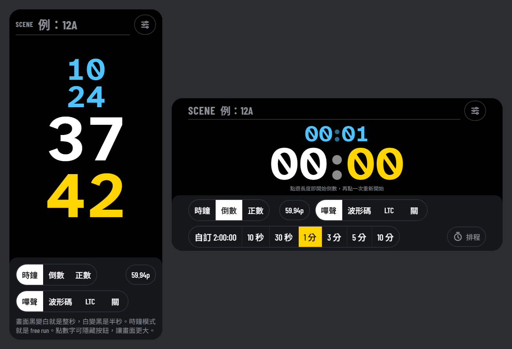
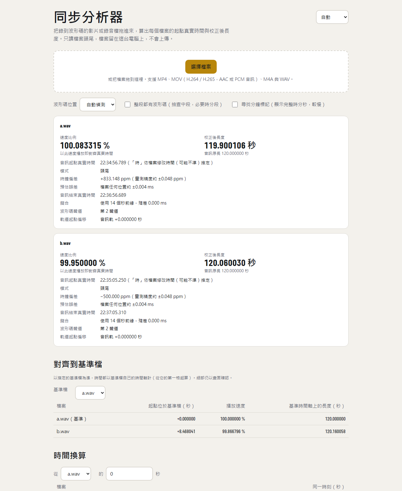

# slate-sync

[English](README.md) · **繁體中文**

**只用一支手機，讓長時間多機錄影、錄音的檔案精準對齊到每一格。**

每台攝影機和錄音機都用自己的時鐘，而時鐘都有誤差。以常見的 833 ppm 來算，兩台設備**錄一小時就差 3 秒**。時間碼盒可以解決，但要花錢，每台設備也得空出一個輸入。

slate-sync 把手機變成同步場記板。每段開頭和結尾各錄一次，分析器讀出每個檔案的**起點真實時間**與**校正後長度**。兩者都正確，檔案裡的每一格畫面、每一個聲音取樣就會落在正確的真實時間上。

[](https://sinnoken.github.io/slate-sync/)
[](LICENSE)



*手機上的同步場記板：直拿時時、分、秒、格分四行，橫拿時兩行；點一下數字可隱藏按鈕。*



*電腦瀏覽器中的同步分析器：兩個分別快 833 ppm、慢 500 ppm 的錄音，對齊到基準檔。*

## 特色

- **手機場記板，免安裝**：開啟網頁、加到主畫面即可，全螢幕，第一次開啟後**離線也能用**。
  - **時鐘、倒數、正數**三種模式，可排程開始。
  - **全螢幕黑白方波**：黑變白就是整秒，只拍得到螢幕的攝影機也能對齊。
  - **聲音同步訊號**：嗶聲、**波形碼**或 **LTC**，支援 23.976–120 fps。
- **用眼睛就能讀的波形碼**：每秒的數字以脈衝數量表示，在任何剪輯軟體的波形畫面都看得出來。不怕削波、限幅、自動增益與有損壓縮；用手機喇叭播放、攝影機內建麥克風收音也能用。
- **瀏覽器拖放分析**：檔案不會上傳，只讀每個檔案的頭尾，不必讀完整段。
  - **每個檔案**：速度比例、校正後長度、起點真實時間、時鐘偏差（ppm）。
  - **對齊到基準檔**：各檔案的起點位置、播放速度，以及任一時刻在檔案之間的換算。
- **繁體中文、English、日本語、한국어**：介面跟著裝置語言自動切換，也可以在頁面上手動選擇。
- **命令列版本**（Python＋ffmpeg）：支援 ffmpeg 能讀的所有格式，可輸出 JSON 供腳本使用。
- **實測精度**：以測試檔驗證，速度比例誤差 0.01–0.06 ppm，起點與長度誤差小於 0.01 毫秒（見[驗證方式與結果](docs/testing.md)）。

## 工作流程

1. **拍攝前**：每台錄音機或攝影機的一個聲道接手機的耳機輸出（MIC 輸入需衰減），場記板切到「波形碼」。沒有音訊輸入的設備，可以用手機喇叭播放、由內建麥克風收音：
   - 手機距麥克風 30 cm 內最穩定；
   - 1 m 內在安靜時仍可用；
   - 不要用 LTC 走空氣傳播。
2. **開頭與結尾**：場記板至少錄 1 分鐘，跨過一次整分鐘才能讀到分鐘標記，中間可以拔掉。只拍得到畫面的攝影機，拍手機螢幕即可。
3. **事後分析**：把所有檔案丟進分析器，或執行 `slate_sync.py`。
4. **在剪輯軟體中**：跨機對齊以畫面為準，分析器的數字用來換算與確認；以速度比例、修正後影格率或校正後長度修正每個檔案。

## 快速開始

| 工具 | 在哪裡用 | 怎麼用 |
|---|---|---|
| **同步場記板** | 手機瀏覽器 | 開啟 <https://sinnoken.github.io/slate-sync/>，點選場記板。安裝方式：iPhone 用 Safari → 分享 → 加入主畫面；Android 用 Chrome → 選單 → 安裝應用程式。 |
| **同步分析器** | 電腦瀏覽器（Chrome、Edge、Firefox 桌面版、Safari 26+） | 開啟同一個網址，選擇分析器，拖入檔案。 |
| **命令列** | Python 3.8+、numpy、ffmpeg | 見下方。 |

```bash
pip install -r python/requirements.txt          # 另需安裝 ffmpeg / ffprobe
python python/slate_sync.py A001.MP4 ZOOM0001.WAV --ref A001.MP4
python python/slate_sync.py *.MP4 --ref A001.MP4 --at B002.MP4=125.5   # B002 的 125.5 秒對應各檔案的哪一秒
```

| 選項 | 說明 |
|---|---|
| `--ref 檔名` | 對齊的基準檔，預設為第一個檔案 |
| `--at 檔名=秒` | 把某檔案的某一刻換算到其他檔案的時間，可重複 |
| `--channel N` | 指定波形碼所在聲道（0 起算），預設自動判斷，頭尾可不同 |
| `--fps 59.94` | 檔案沒有記錄影格率時指定；29.97、59.94 等自動使用精確分數 |
| `--only head`／`--only tail` | 只錄了開頭／結尾：略過另一端的搜尋（不加也會自動判斷，只是較慢） |
| `--full` | 整段都有波形碼：抽查中段 3 處，偏離直線超過 2 ms 時改為分段調速 |
| `--probe N` | 中段抽查處數（隱含 `--full`），越多分段越細 |
| `--target 1` | 目標精度：檔案任何位置的預估誤差（ms），達到即停止讀取 |
| `--search 30`／`--max-read 120` | 每端最多往內找幾分鐘／找到後最多再讀幾秒 |
| `--minute` | 讀到波形碼後再多讀約 1 分鐘尋找分鐘標記，以顯示完整的時分秒（預設讀到就停） |
| `--json` | 以 JSON 輸出 |

## 模式

分析器會自動判斷模式，並在報告中標示。

| 你錄了 | 模式 | 說明 |
|---|---|---|
| 開頭與結尾 | 頭尾 | 兩端一起擬合，精度最好 |
| 只有開頭或只有結尾 | 僅開頭／僅結尾 | 用該端的局部速率；未涵蓋整段，機身溫度變化可能造成偏差 |
| 整段（加 `--full`） | 全段 | 抽查中段；漂移不是直線時輸出分段調速 |

所有讀到的秒都放進同一個擬合。分析器一邊讀一邊估算「檔案任何位置的預估誤差」，達到目標精度就停止。

## 精度與限制

- **測試檔精度**：速度比例誤差約 0.01–0.06 ppm，起點與長度誤差在 0.01 毫秒以內；削波 20 dB 時速度誤差約 1 ppm。詳見 [docs/testing.md](docs/testing.md)。
- **以直線修正**：分析器用頭尾之間的一條直線修正。拍攝中速率若有變化（例如溫度），中段會偏離直線，可用 `--full` 實測。
- **長度不限**：頭尾之間經過幾個整分鐘，由兩端各自量到的時鐘比例推算，不需要分鐘標記。
- **起點時間範圍**：跨檔案的起點位置以秒數判定，各檔案開始時間相差須在 ±30 秒內（加 `--minute` 讀到分鐘標記時為 ±30 分鐘）；跨機對齊以畫面為準。
- **音訊軌**：只讀第一條音訊軌。
- **格式**：網頁版不支援 AVCHD（.MTS，多為 AC-3 音訊）、MXF 與片段式（fragmented）MP4，請改用 Python 版。
- **實際設備**：所有驗證都以軟體產生的訊號進行，正式使用前請先用自己的設備錄一段確認。

## 自行架設

兩個網頁工具都是單一 HTML 檔，不需要建置，也沒有伺服器程式。

- **GitHub Pages**：fork 這個 repo，在 Settings → Pages 把 Source 設為「GitHub Actions」。之後每次推到 `main`，[`.github/workflows/pages.yml`](.github/workflows/pages.yml) 會自動發布 `web/`。任何支援 HTTPS 的靜態網站空間也可以。
- **在本機開啟分析器**：分析器用 WebCodecs 解碼 AAC，必須在 `https://` 或 `http://localhost` 下開啟。直接用 `file://` 開啟時，只能分析 WAV 與 PCM 音訊。
  ```bash
  python -m http.server 8000      # 在 repo 根目錄執行，然後開啟 http://localhost:8000/web/sync-analyzer.html
  ```
- **更新與離線**：已安裝的 App 會在背景下載新版，下次開啟就是新版。只有修改 Service Worker 本身、或要清掉舊快取時，才需要改 [`web/sw.js`](web/sw.js) 的 `VERSION`。

## 檔案結構

| 路徑 | 內容 |
|---|---|
| [`web/sync-slate.html`](web/sync-slate.html) | 同步場記板（手機 PWA） |
| [`web/sync-analyzer.html`](web/sync-analyzer.html) | 同步分析器（電腦瀏覽器） |
| [`python/slate_sync.py`](python/slate_sync.py) | 命令列版分析器 |
| [`tests/make_test_media.py`](tests/make_test_media.py) | 產生已知漂移量的測試檔 |
| [`docs/waveform-code.md`](docs/waveform-code.md) | 波形碼格式規格 |
| [`docs/testing.md`](docs/testing.md) | 驗證方式與結果 |
| [`CHANGELOG.md`](CHANGELOG.md) | 更新紀錄 |

## 授權

[MIT](LICENSE)
